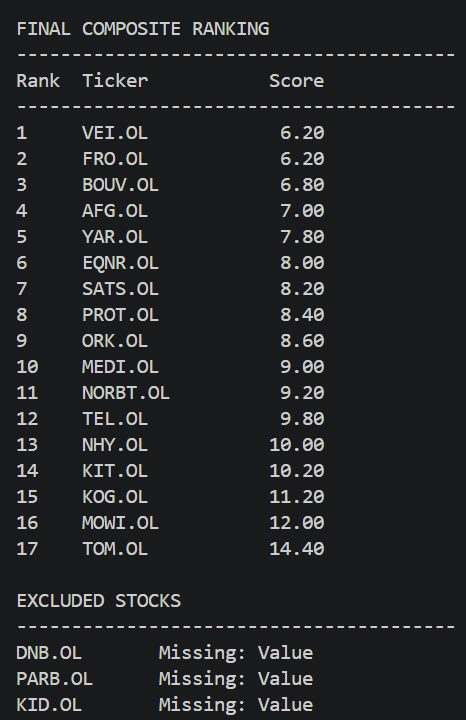

# Factor-Based Stock Screener

A Python-based stock screener inspired by my previous work experience and the book *Your Complete Guide to Factor-Based Investing* by Andrew L. Berkin and Larry E. Swedroe.

This project is an initial implementation of a multifactor investing strategy using financial data from Yahoo Finance through the `yfinance` library.

The screener ranks 20 companies listed on the Oslo Stock Exchange based on five factors:

- **Low Beta:** Market beta
- **Size:** Market capitalization
- **Value:** P/E, P/B, P/S and EV/EBITDA (composite ranking)
- **Momentum:** Past 12-month returns, excluding the most recent month
- **Profitability:** Return on Equity (ROE)

Each factor receives an equal weight of 20% in the final composite score. A lower score indicates a better overall ranking.

## Example Output



## Limitations and Future Improvements

This project is a starting point for a factor-based investing strategy, with several limitations and opportunities for improvement:

- **Data quality:** Yahoo Finance data may contain missing or inaccurate information. Some financial metrics, such as ROCE, EV/EBIT and EV/Gross Profit, are not directly available through `yfinance` and have therefore not been included. Additionally, certain financial metrics may be unavailable for some stocks.
- **Additional metrics:** Profitability could be improved by combining ROE with ROCE (and eventually gross profit), while the value factor could include EV/EBIT and EV/Gross Profit. Momentum could also be calculated using more precise monthly dates instead of approximating one month as 22 trading days.
- **Stock universe:** The screener currently includes only 20 Norwegian stocks. A more comprehensive strategy could use a larger stock universe, such as the S&P 500, to allow for broader diversification.
- **Factor selection:** The factors and their weights could also be adjusted, for example by replacing the profitability factor with a broader quality factor.
- **Backtesting:** Historical testing would be needed to evaluate performance, risk and transaction costs before considering practical use.

## Installation

Install the required dependencies:

```bash
pip install -r requirements.txt
```

Run the screener:

```bash
python3 stock_screener.py
```

## Disclaimer

This project is intended for educational purposes only and does not constitute financial or investment advice. The rankings are based on publicly available financial data and do not guarantee future investment performance.